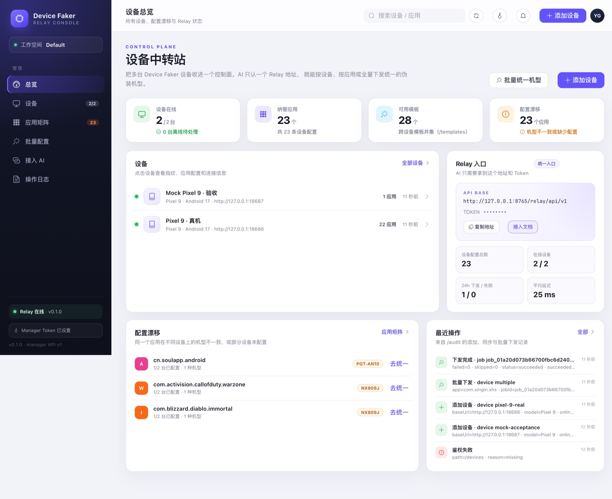
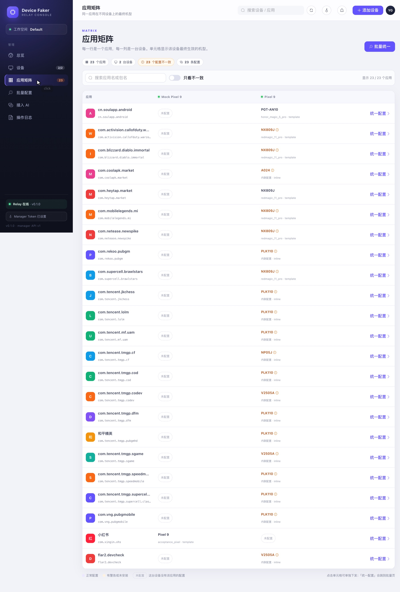

# t7 端到端验收报告（Manager / Relay）

- 日期：2026-11-24（Asia/Shanghai）
- 验收人：test-verifier
- 代码：工作区 `d9aa881`（`manager/` 为未提交工作树；本报告只验证当前工作树）
- 结论：**通过**。真实 Pixel 9（只读）与 Mock 设备同时纳管；healthz、设备列表、overview、apps 矩阵、一次 Mock apply、job 查询、WebUI 静态托管与页面均验证通过；fmt / test / vue-tsc / npm build 全部通过。
- 原始日志：[t7-build.log](t7-build.log)、[t7-api.log](t7-api.log)、[t7-api-retry.log](t7-api-retry.log)（首次含 jq 解析失败的记录）、[t7-checks.log](t7-checks.log)、[t7-manager.log](t7-manager.log)、[t7-mock.log](t7-mock.log)、[t7-meta.log](t7-meta.log)

## 1. 环境

| 项 | 值 |
| --- | --- |
| 主机 | macOS（本地 loopback 验收） |
| Rust | rustc 1.99.0 / cargo 1.99.0 |
| Node / npm | v26.13.1 / 11.20.0 |
| 真机 | Pixel 9（`4A190DLAQ002QR`），Android 17 / SDK 37，Device Faker 1.9.0 |
| 真机接入 | `adb forward tcp:18686 tcp:8686`（只读） |
| Mock 设备 | `manager/docs/mock_device.py 18687` |
| Manager | `http://127.0.0.1:8765`，数据目录 `/tmp/dfm-acceptance`（干净创建，0700） |
| WebUI | `manager/webui/dist`，由 Manager 同进程托管 |

## 2. 构建

命令与完整输出见 [t7-build.log](t7-build.log)。

| 命令 | 结果 |
| --- | --- |
| `cargo build -p device_faker_manager` | exit 0 |
| `cd manager/webui && npm install` | exit 0（仅 fsevents 安装脚本提示，无错误） |
| `npx vue-tsc --noEmit` | exit 0 |
| `npm run build` | exit 0，产物 `dist/index.html` + `assets/*`（Vite 8.3.8，1624 modules，约 375–416 ms） |

## 3. 启动（干净数据目录）

    # Mock 设备
    python3 manager/docs/mock_device.py 18687

    # Manager（干净数据目录；默认 Token admin123，仅 loopback）
    ./target/debug/device_faker_manager \
      --bind 127.0.0.1:8765 \
      --data-dir /tmp/dfm-acceptance \
      --static-dir manager/webui/dist

启动日志（[t7-manager.log](t7-manager.log)）：

    WARN 正在使用默认 Manager Token admin123；建议用 --token / DFM_TOKEN / manager.token 轮换
    INFO Device Faker Manager 启动中 version="0.1.0" bind=127.0.0.1:8765 data_dir=/tmp/dfm-acceptance token_source="default"
    INFO 已生成 Manager 设备 Token 密钥 file=/tmp/dfm-acceptance/manager.key
    INFO 静态托管已启用 dir=manager/webui/dist
    INFO Manager 已就绪 address=127.0.0.1:8765

数据目录（首次启动自动创建，`ls -la` 见 [t7-meta.log](t7-meta.log)）：

    drwx------  /tmp/dfm-acceptance
    manager.db / manager.db-wal / manager.db-shm   # schemaVersion=1，WAL
    manager.key                                    # 32 B，0600

DB 计数（验收结束时）：`devices=2`、`overviews=2`、`jobs=1`、`job_results=1`、`audit=11`（其中 7 条为 401 测试产生的 `auth.failed`，4 条为设备/下发操作）。截图中的操作日志页在 401 测试前采集，显示 5 条（4 成功 / 1 失败）。

## 4. API 验收

完整命令与响应见 [t7-api.log](t7-api.log)。

| 检查 | 命令 | 结果 |
| --- | --- | --- |
| healthz（无鉴权） | `GET /relay/api/v1/healthz` | 200，`status=ok`，`apiVersion=v1`，`db.schemaVersion=1`，`devices.total=0`（启动时） |
| 未带 Token | `GET /relay/api/v1/devices` | 401，`error.code=unauthorized`，`retryable=false` |
| 添加 Mock 设备 | `POST /devices`（`id=mock-acceptance`，`baseUrl=http://127.0.0.1:18687`） | 201，`online=true`，`model=Pixel 9`，`latencyMs=2` |
| 添加真机（只读探测） | `POST /devices`（`id=pixel-9-real`，`baseUrl=http://127.0.0.1:18686`） | 201，`online=true`，`model=Pixel 9`，`android=17`，`latencyMs=505` |
| 设备列表 | `GET /devices` | `total=2`，`online=2`，`offline=0` |
| 真机 overview（实时） | `GET /devices/pixel-9-real/overview` | 200，`online=true`，`stale=false`，`templates=26`，`apps=22` |
| 真机 overview（缓存） | `GET /devices/pixel-9-real/overview?cached=1` | 200，`stale=false`，模型一致 |
| apps 矩阵 | `GET /apps` | `totals={apps:23, appsConfigured:23, driftApps:23, devices:2}`；23 行均为“单设备已配置” |
| 模板并集 | `GET /templates` | `total=27`（apply 前；真机 26 + Mock 1） |
| Mock 下发 | `POST /apply`，`devices=["mock-acceptance"]`，模板对象 `acceptance_pixel`，`restart=true` | 202，`status=queued`，`total=1`，返回 `jobId`/`pollUrl` |
| job 查询 | `GET /jobs/{id}` | `status=succeeded`，`succeeded=1`，`skipped=0`，`failed=0`，`attempts=2` |
| job 步骤 | 同上 | `revision → template_get → template_put → bind(412) → revision → bind → restart`，`restart.status=ok` |
| jobs 列表 | `GET /jobs?limit=5` | `total=1`；`items` 与兼容别名 `jobs` 内容一致 |
| overview 总览 | `GET /overview` | `fleet.devices=2`、`apps=23`、`templates=28`、`jobs.last24h=1`、`drift=23` |
| 审计 | `GET /audit?limit=10` | `job.finished`、`apply.bulk(device:multiple)`、`device.add ×2`、`auth.failed` |
| 代理（真机只读） | `GET /devices/pixel-9-real/proxy/api/v1/apps/com.coolapk.market` | 200，`source.type=inline`，`resolved.model=A024` |
| 代理（Mock） | `GET /devices/mock-acceptance/proxy/api/v1/apps/com.xingin.xhs` | 200，`source.type=template`，`template=acceptance_pixel`，`model=Pixel 9` |
| 代理 404 | 不存在的模板 / 未注册设备 | 404 原样透传 / 404 `device_not_found` |

### 4.1 真实 Pixel 9（只读）

- 通过 `adb forward tcp:18686 tcp:8686` 访问设备端 `/api/v1`；验收期间**只调用 GET**（status、overview、apps），未修改任何设备配置。
- 设备端 status：`module v1.9.0 / server 1.9.0`、`Android 17 / SDK 37`、`templates=26 / apps=15`；Manager 探测耗时 505 ms。
- 设备 overview：`templates=26`、`apps=22`（含内联配置），与 Manager 缓存一致。
- 真机与 Mock 同时在线：设备列表、apps 矩阵（23 行）、overview 均展示两台设备。

### 4.2 Mock apply / job 详情

    {
      "id": "job_01a20d073b66700fbc6d24035f425af7",
      "status": "succeeded",
      "kind": "bulk",
      "total": 1,
      "succeeded": 1,
      "skipped": 0,
      "failed": 0,
      "results": [{
        "deviceId": "mock-acceptance",
        "status": "ok",
        "httpStatus": 200,
        "attempts": 2,
        "steps": ["revision","template_get","template_put","bind","revision","bind","restart"],
        "restart": {"status": "ok"}
      }]
    }

首次绑定返回 412（Mock 的 `FORCE_412_ONCE` + 模板 PUT 推进 revision），Relay 重取 revision 后重试一次成功。

## 5. WebUI 与静态托管

- `GET /`：200 `text/html`，`Cache-Control: no-cache`，含 `X-Content-Type-Options: nosniff`、`Referrer-Policy: no-referrer`、CSP。
- `GET /assets/index-*.js`：200，`Cache-Control: public, max-age=31536000, immutable`。
- `GET /devices`（前端路由）：200，SPA fallback 返回 `index.html`。
- 浏览器实测：
  - 写入错误 Token 后刷新：页面显示「Relay 请求失败 / Manager Token 无效或已轮换」，弹出 Token 对话框，计数为 0；
  - 输入正确 Token `admin123` 后恢复：设备 `2/2`、应用 `23`、模板 `28`、漂移 `23`，与 API 一致；
  - 操作日志页读取 `GET /audit`：截图时显示 5 条记录（4 成功 / 1 失败，失败为 API 401 校验）；随后执行的 WebUI 401 测试又追加 6 条 `auth.failed`，最终 DB 为 11 条。

截图（保存于本目录）：

| 截图 | 内容 |
| --- | --- |
| [06-t7-token-dialog.jpg](06-t7-token-dialog.jpg) | 错误 Token → 401 错误条 + Token 对话框（恢复前） |
| [07-t7-dashboard.jpg](07-t7-dashboard.jpg) | 总览：2/2 在线、23 应用、28 模板、23 漂移、Relay 入口、最近操作 |
| [08-t7-devices.jpg](08-t7-devices.jpg) | 设备页：Mock Pixel 9 · 验收 / Pixel 9 · 真机 |
| [09-t7-apps-matrix.jpg](09-t7-apps-matrix.jpg) | 应用矩阵：23 行 × 2 设备，Mock 的「小红书」显示 `acceptance_pixel` |
| [10-t7-batch.jpg](10-t7-batch.jpg) | 批量配置页 |
| [11-t7-relay.jpg](11-t7-relay.jpg) | 接入 AI 页：Base URL、Token（掩码）、curl 示例、端点表 |
| [12-t7-logs.jpg](12-t7-logs.jpg) | 操作日志：`GET /audit` 真实数据与失败原因 |

## 6. 自动检查

完整输出见 [t7-checks.log](t7-checks.log)。

| 命令 | 结果 |
| --- | --- |
| `cargo fmt --check` | exit 0 |
| `cargo test -p device_faker_manager` | exit 0；**53 unit + 52 integration**（manager_api 16、devices_flow 13、apply_flow 11、ops_endpoints 8、e2e_flow 4），0 failed |
| `cd manager/webui && npx vue-tsc --noEmit` | exit 0 |
| `cd manager/webui && npm run build` | exit 0；1624 modules，dist 生成成功 |
| 检查后 healthz | 200，`devices.total=2`，`jobs.queued=0` |

## 7. 失败与重试

1. **验收脚本 jq 解析失败（非产品缺陷）**：第 9 步把 `curl -w 'HTTP 202'` 的输出一起 tee 进 JSON 文件，导致后续 `jq` 报 `Invalid numeric literal`；job 已在报错前创建。重试时从文件首行提取 `jobId` 继续轮询，**未重复提交 apply**。见 [t7-api-retry.log](t7-api-retry.log) 的 `RETRY note`。
2. **Proxy 首轮取错端点（非产品缺陷）**：Python Mock 只实现 status/overview/revision/templates/apps，没有测试用 axum Mock 的 `/api/v1/echo`；首次 `jq` 得到 `method=null`。改用 `/api/v1/apps/{pkg}` 在 Mock 与真机上验证代理，均返回正确来源与机型。真机 `com.xingin.xhs` 未配置，改用已配置的 `com.coolapk.market`。
3. **401 流程验证**：故意写入错误 Token 触发 WebUI 401 与 Token 对话框，再输入正确 Token 恢复；最终审计 11 条中有 7 条 `auth.failed`（1 条来自 API 无 Token 校验，6 条来自 WebUI 错误 Token），属预期测试痕迹。
4. 无构建、测试、启动或接口级阻塞失败。

## 8. 已知限制

- 真机验收为**只读**（status/overview/apps），未执行 apply、restart 或任何设备配置写入；Mock 设备承担写入链路验收。
- API §2.10 的 assignment 60s 总时限当前未硬性实施（仅单请求超时），已记录在 API.md / ARCH §17；本次 job 在 1 秒内完成，未触发。
- WebUI 尚未提供 PATCH 设备、独立 jobs 列表页、audit 服务端过滤 UI；设备列表一次拉取较多数据，未做分页 UI（见 t5 交付说明）。
- Manager 使用默认 Token `admin123` 仅因监听 loopback；部署到局域网必须换 Token 并前置 TLS/隧道。
- 本次截图在 2800×1608 视口（DPR 2）下采集，已统一缩放为宽 1800 的 JPEG。
- `/tmp/dfm-acceptance`、`/tmp/t7-*.log` 为本地临时产物，验收结束后可删除；仓库内只保留本报告、日志副本与截图。

## 9. 验收清单

| 要求 | 状态 | 证据 |
| --- | --- | --- |
| 从干净数据目录构建并启动 Manager | ✅ | 第 2、3 节；healthz 200 |
| Mock 设备或 adb forward 真机（只读 overview） | ✅ | Mock 18687 + 真机 18686 同时纳管；真机 overview 26 模板 / 22 应用 |
| healthz | ✅ | 200，`status=ok`，schema 1 |
| 添加设备 / 设备列表 | ✅ | 201 ×2；列表 2/2 在线 |
| apps 矩阵 | ✅ | 23 应用 × 2 设备，漂移 23 |
| 一次 apply（模拟设备） | ✅ | 202，job `succeeded`，`attempts=2`，restart ok |
| job 查询 | ✅ | `GET /jobs/{id}` 与 `GET /jobs` 均通过 |
| 构建 WebUI + 静态托管真实页面 | ✅ | `vue-tsc`/`vite build` exit 0；index/资产/SPA 200；浏览器截图 |
| `cargo fmt --check` | ✅ | exit 0 |
| `cargo test` | ✅ | 105 tests 全绿 |
| `npm run build` / `npx vue-tsc --noEmit` | ✅ | exit 0 |
| 验收日志与截图保存到 `docs/design/manager-ui/` | ✅ | 本报告 + `t7-*.log` + `06`–`12` 截图 |

## 10. 产物索引

- 报告：[t7-acceptance.md](t7-acceptance.md)
- 日志：[t7-build.log](t7-build.log)、[t7-api.log](t7-api.log)、[t7-api-retry.log](t7-api-retry.log)、[t7-checks.log](t7-checks.log)、[t7-manager.log](t7-manager.log)、[t7-mock.log](t7-mock.log)、[t7-meta.log](t7-meta.log)
- 截图：[06-t7-token-dialog.jpg](06-t7-token-dialog.jpg)、[07-t7-dashboard.jpg](07-t7-dashboard.jpg)、[08-t7-devices.jpg](08-t7-devices.jpg)、[09-t7-apps-matrix.jpg](09-t7-apps-matrix.jpg)、[10-t7-batch.jpg](10-t7-batch.jpg)、[11-t7-relay.jpg](11-t7-relay.jpg)、[12-t7-logs.jpg](12-t7-logs.jpg)
- 启动脚本/文档：[RUN.md](../../../manager/docs/RUN.md)
