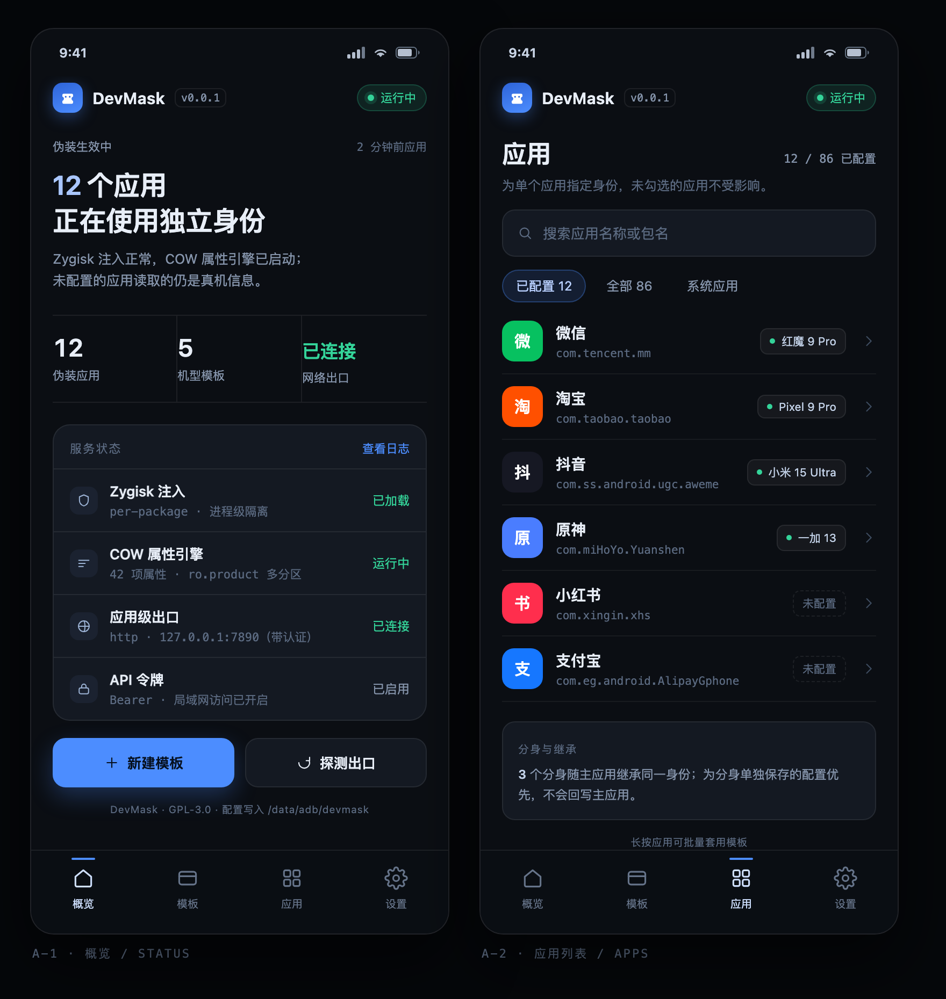
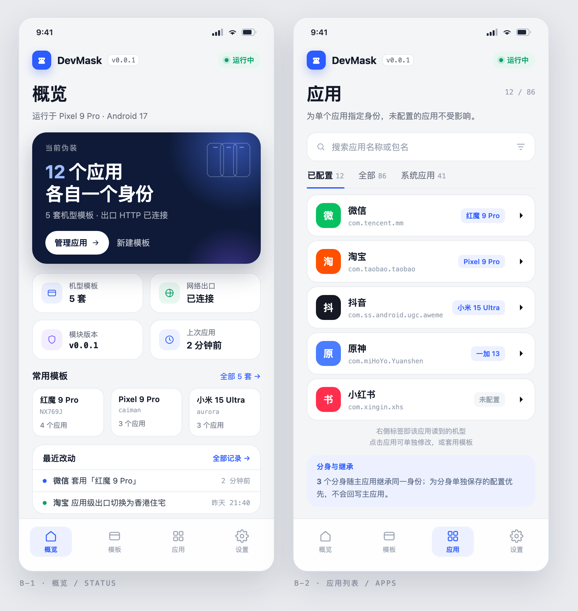
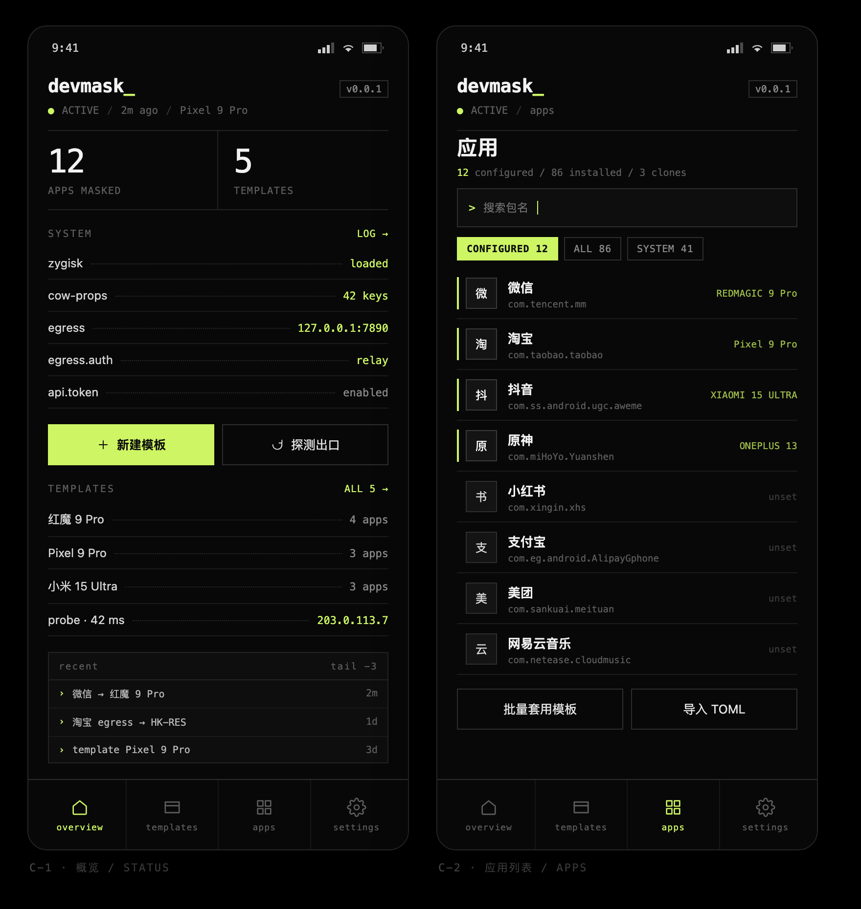

# DevMask WebUI 改版 · 方向提案

- 版本口径：**v0.0.1**（模块 / WebUI / Manager / 站点统一）
- 日期：2026-11-26
- 状态：**已定稿（2026-11-26）**：只保留 A / B；底部导航 5 项；默认跟随系统；关注/译者收进「关于」；Manager 后续单独一轮
- 影响范围：`webui/`（设备端 WebUI）；Manager 控制台不在本轮

## 1. 这一轮要解决什么

现状（0.0.1 改名后未动 UI）：

- 视觉仍是上游 Device Faker 的「天蓝 → 紫渐变 + 毛玻璃卡片」，与 DevMask 的品牌叙事无关
- 「概览」只有 5 行模块信息，回答不了"现在生效吗 / 哪些应用被伪装 / 出口通不通"
- 「应用」列表看不出每个包实际读到什么机型，只能点进去才知道
- 「设置」一页塞了主题、语言、调试、API、网络出口全套表单，出口配置被埋得很深
- 版本文案不一致：`webui/package.json`、`website/package.json` 还是 1.7.0（本轮已改为 0.0.1）

本轮目标：

1. 让 UI 说清 DevMask 的一句话——**一个应用，一个身份**
2. 概览一眼回答：生效没 / 多少应用 / 几个模板 / 出口通不通
3. 应用列表直接展示"该包读到的机型"，未配置与已配置一眼可分
4. 设置按「外观 / 网络 / 高级」分层，出口不再埋在表单里

## 2. 三个方向

### 方向 A · 静默 Stealth（深色仪表盘）

| | |
| --- | --- |
| 关键词 | 状态优先、hairline 分隔、单一蓝 + 状态绿、数字大而克制 |
| 气质 | root 工具 / 仪表盘，像在看一台正在工作的机器 |
| 适合 | 夜间使用、极客用户、希望"打开就知道状态" |
| 代价 | 需要再做一套浅色 token；模板编辑表单（几十个字段）要单独设计密度 |

要点：无卡片堆叠，靠 1px 分隔线和大字号数字建立层级；顶部常驻"运行中"；服务状态逐行给出 loaded / running / connected。

### 方向 B · 证件 Passport（浅色卡片）

| | |
| --- | --- |
| 关键词 | 白卡、深海军蓝 hero、18–22px 圆角、单一品牌蓝 `#2C5BFF` |
| 气质 | 产品化、干净、截图友好，像"每个应用一张身份证" |
| 适合 | 大众用户、酷安/社群传播、浅色为主的日常使用 |
| 代价 | 信息密度较低，页面更长；卡片层级过多时容易"糊" |

要点：hero 卡承担"12 个应用各自一个身份"的叙事；2×2 指标块回答状态；应用行右侧直接是机型标签。

### 方向 C · 终端 Native（黑白 + 荧光绿）

| | |
| --- | --- |
| 关键词 | 等宽字体、直角 1px 边框、lime `#CDF564`、无渐变无阴影 |
| 气质 | 与 CLI / API / 配置文件同一语言，硬核、克制 |
| 适合 | 极客用户、作为"高级外观"或 Manager 控制台（宽屏） |
| 代价 | 中文正文配 mono 的长期可读性一般；Element Plus 组件需大量覆盖；受众偏窄 |

要点：`devmask_` 标题即品牌；`key ......... value` 的对齐表读起来像 `devmask status` 的输出。

## 3. 横向对比

| 维度 | A 静默 | B 证件 | C 终端 |
| --- | --- | --- | --- |
| 第一眼 | 专业、冷静 | 亲切、完整 | 硬核、独特 |
| 信息密度 | 高 | 中 | 高 |
| 深浅色成本 | 低（先深后浅） | 中（先浅后深） | 低（只做深色） |
| Element Plus 改造成本 | 中 | **低** | 高 |
| 截图 / 传播 | 中 | **高** | 中 |
| 4 页 + 弹窗工作量 | 中 | 中 | 高 |
| 主要风险 | 深色下表单对比度 | 卡片层级失控 | 品牌接受度、可读性 |

## 4. 建议

**决策：B 的结构 + A 的深色令牌，一套 DOM、两套主题；C 已排除。**

理由：

- WebUI 的核心任务是"配置"，可读性和表单友好度优先，B 的浅色卡片最容易承载模板的几十个字段
- "每个应用一张身份卡"的隐喻与产品定位一致，截图传播也最好
- A 的结构（指标 + 服务状态 + 最近改动）可以直接搬到 B；两者共用同一套语义 token，只换色值
- C 适合 Manager 控制台那种宽屏、偏运维的场景，单独一轮更划算

如果你更看重"工具感"和夜间使用，直接选 A；两者不冲突——B 是默认，A 是深色模式。

## 5. 设计令牌

### B（推荐默认）

| Token | 值 | 用途 |
| --- | --- | --- |
| `--bg` | `#F4F5F7` | 页面底色 |
| `--surface` | `#FFFFFF` | 卡片 |
| `--ink` / `--muted` | `#111827` / `#6B7280` | 主文字 / 次文字 |
| `--line` | `#E9EBF0` | 1px 边框、分隔 |
| `--brand` | `#2C5BFF` | 主操作、选中态 |
| `--brand-soft` | `#EDF1FF` | 标签底、选中底 |
| `--navy` | `#0E1A38` | hero 卡 |
| `--ok` / `--ok-soft` | `#0E9F6E` / `#E7F7F0` | 运行中、已连接 |
| 圆角 | 卡 18 / 按钮 12 / 胶囊 99 | |
| 字体 | 系统中文 + `SF Mono` 仅用于版本、包名、数值 | |

### A（深色主题）

| Token | 值 |
| --- | --- |
| `--bg` | `#0B0E13` |
| `--surface` / `--surface2` | `#141922` / `#1B2230` |
| `--text` / `--muted` | `#E8EEF7` / `#8695AC` |
| `--line` | `rgba(255,255,255,.075)` |
| `--accent` | `#4C8DFF` |
| `--ok` | `#34D399` |
| 圆角 | 卡 16 / 按钮 12 |

### C（备选）

| Token | 值 |
| --- | --- |
| `--bg` / `--surface` | `#080808` / `#0E0E0E` |
| `--line` | `#232323` |
| `--text` / `--muted` | `#F2F2F2` / `#8A8A8A` |
| `--lime` | `#CDF564` |
| 圆角 | 0–2（直角） |

## 6. 页面级改动（与方向无关）

| 页面 | 改动 |
| --- | --- |
| 概览 | 版本降级为 pill；新增"生效中"主语、指标行（应用 / 模板 / 出口）、服务状态、最近改动；「关注模块 / 译者」收进设置或关于页 |
| 应用 | 行内展示该包读到的机型；已配置 = 实心标签，未配置 = 虚线标签；分身显示「继承」；搜索与筛选固定在顶部 |
| 模板 | 卡片只留机型名 + 型号代码 + 套用应用数；完整字段进编辑页；冲突提示保留 |
| 设置 | 拆两组：外观（主题/语言）、高级（调试/API/日志）；新增「关于」分组（版本、作者、仓库、关注模块、译者、许可） |
| 网络（新） | 从设置页独立出来的第 5 个 tab：出口开关、代理表单、认证中继、探测与直连回滚 |
| 在线模板库 | 搜索 + 列表 + 预览抽屉；沿用现有一次拉取 `templates.toml` 的实现 |
| 空状态 | 统一"一句解释 + 一个主操作"；骨架屏 3 行，不做转圈 |

## 7. 文案规范

- 术语：**身份**（不说"伪装配置"）、**模板**、**出口**、**分身**、**中继**
- 数量：`12 个应用` / `5 套模板`；纯数值用等宽字体
- 状态词：`运行中 / 已加载 / 已连接 / 未配置`
- 版本：任何界面一律 `v0.0.1`，不再出现 1.7.0
- 空状态：说清"为什么空"和"下一步点哪"

## 8. 本轮已改的文案（不依赖 UI 决策）

- `module/module.prop`：description 改为「按应用伪造机型、Build 指纹与系统属性；可为单个应用指定出口代理」
- `Update.json`：新建（原先 `updateJson` 指向仓库里不存在的文件），指向 v0.0.1 release 与 CHANGELOG
- `website/docs/index.md`、`en/index.md`：hero 改「一个应用，一个身份 / One app, one identity」，特性改为 5 条能力
- `website/docs/guide/index.md`、`en/guide/index.md`：重写项目简介（它解决什么 / 能力一览 / 快速开始 / WebUI / 在线模板库）
- `docs/README.md`、`en/README.md`、`tr/README.md`：首段改为"一个应用，一个身份"
- `.vitepress/locales/index.ts`：站点描述同步
- `webui/package.json`、`website/package.json`：1.7.0 → 0.0.1

## 9. 选定方向后的落地顺序

1. 把 token 落到 `webui/src/style.css`，废弃天蓝→紫渐变与玻璃卡（保留 `.dark` 切换）
2. App shell：header（品牌 + 版本 pill + 状态）、底部导航、页面转场、overscroll 保留
3. 页面顺序：概览 → 应用 → 模板 → 设置 → 各弹窗
4. 截图回归（浅色 / 深色 / 空态 / 骨架屏）
5. `python webui/build_webui.py`（type-check + lint + build）通过后提交
6. 更新 `website/docs/guide/webui.md` 的界面说明

## 10. 决策与待办

已定：

- [x] 方向：**只保留 A / B**，C 排除；实现为 B 结构 + A 深色令牌（同一 DOM，切主题不跳动）
- [x] 导航：**5 项** —— 概览 / 模板 / 应用 / 网络 / 设置，网络出口独立成页
- [x] 默认主题：**跟随系统**
- [x] 「关注模块 / 译者」收进设置页「关于」分组
- [x] Manager 控制台：后续单独一轮，不进本次

补充确认（2026-11-26）：

- [x] 深色**保留卡片**：1px hairline + 去阴影，即 A 的质感、B 的骨架
- [x] 网络页页头**常驻「一键直连」**按钮

## 11. 交付结果（2026-11-26）

- 团队：6 成员 / 9 个任务（t1–t9）全部完成；t5、t8、t9 为独立验收轮
- 代码：`webui/` 24 个源文件改写 + 新增 `pages/NetworkPage.vue`、`components/network/**`（6 个组件 + network.css）
- 文档：站点中英 hero / 简介、README 三语首段、`module/module.prop` description、新建 `Update.json`、版本统一 0.0.1
- 构建：`python webui/build_webui.py` 全绿（type-check + eslint --max-warnings 0 + build，产物 898–913 KB）
- 视觉验收：五页浅深 10 张 final 截图 + 交互回归 13 步 × 双主题，0 JS 异常
- 关键对比度实测：禁用主按钮 深 5.46 / 浅 4.35；深色 muted pill 底 1.21、字 5.24；分区标题 6.36；运行中 pill 4.64

已知遗留（不阻塞）：

- **R3**：深色删除确认按钮白字 on `#F87171` = 2.77:1，需单独覆盖删除按钮底色（不动 `--el-color-danger`，否则错误文字一起变暗）
- **R6**：模板既无 `marketname` 也无 `model/device/product` 时，概览卡标题退回 TOML key，超长 key 仍会断词（已加 `:title` 兜底提示）
- **未做**：Manager 控制台（后续单独一轮）；概览「服务状态」块（Zygisk / COW / 中继状态暂无 API，等后端信号）
- 证据目录 `review/` 共 68 张截图 / 11 MB，含中间轮次，可按需裁剪
