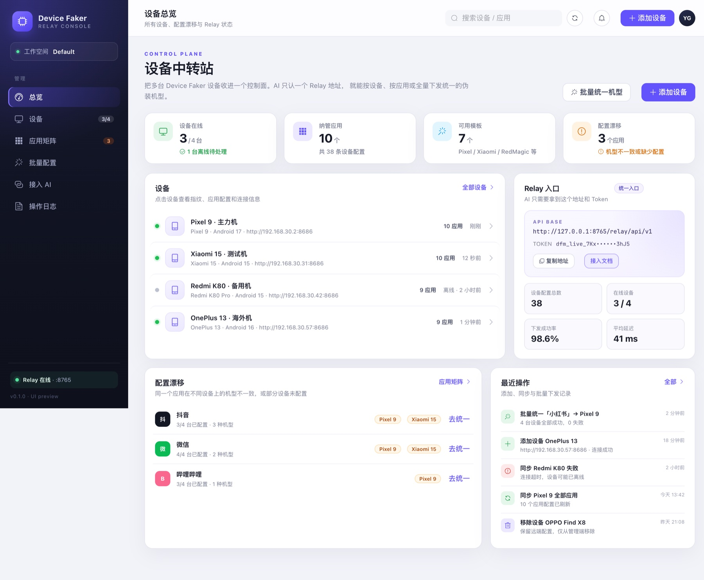
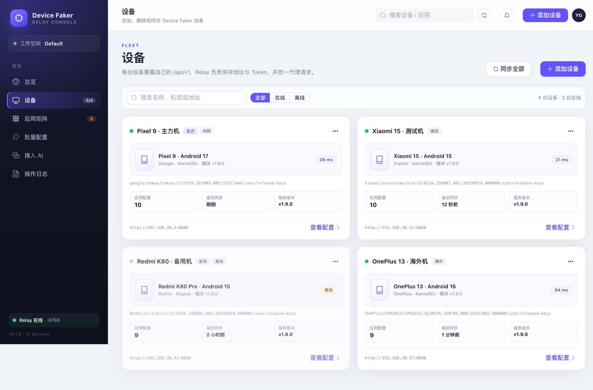
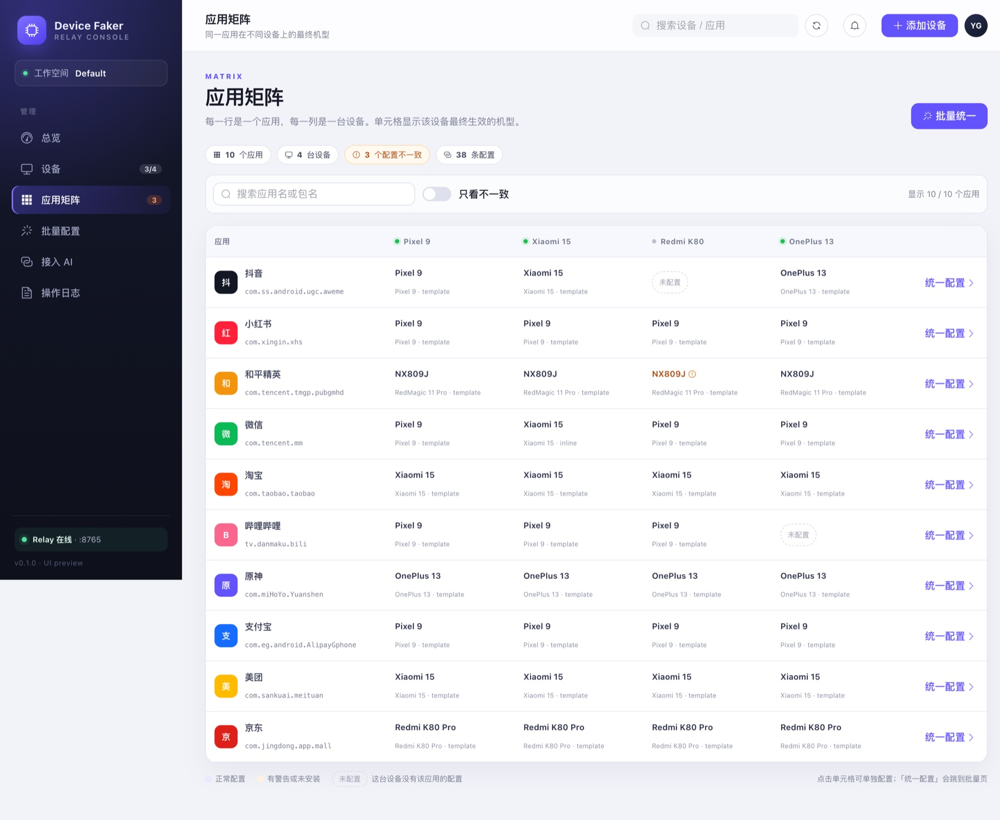
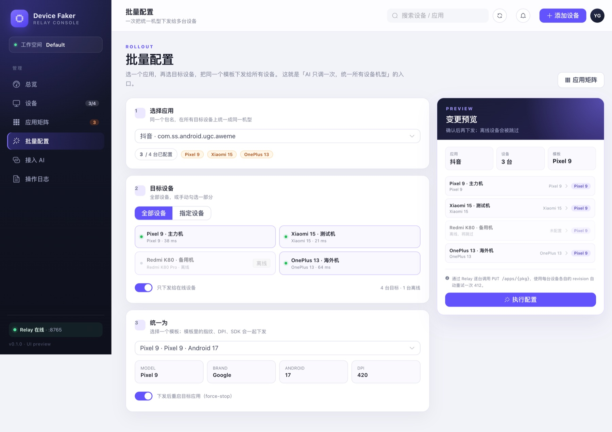
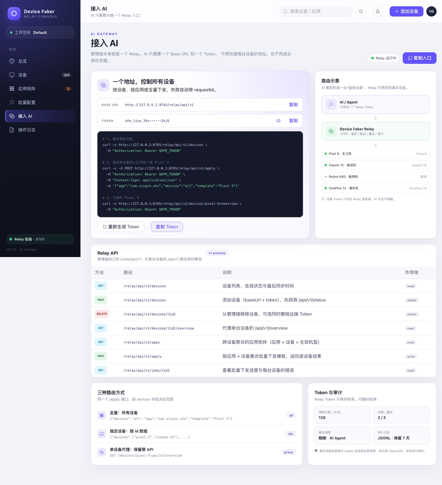

# Device Faker Manager

管理多台 Device Faker 设备，并把它们聚合成一个 AI 可直接调用的 Relay：
Rust（axum + SQLite）单进程服务 + Vue 3 管理端，同进程托管。

> 状态（2026-11-24）：**服务端、WebUI、集成测试与运行文档均已落地**。
> - 契约：[docs/API.md](docs/API.md)、[docs/ARCH.md](docs/ARCH.md)、[docs/api-types.ts](docs/api-types.ts)
> - Relay 服务端：`manager/src`（27 个方法级端点（含出口代理池）、SQLite schema v2、AES-256-GCM 设备 Token 与代理凭据、job runner（`kind=bulk/assignments/egress`））
> - WebUI：`manager/webui`，已接真实 Relay API（loading / 401 / 空态 / 逐设备结果）
> - 集成测试与 Mock 设备：`manager/tests`（含 `e2e_flow` 全流程、`egress_flow` 出口下发与 `review_reverify` 复审回归）
> - 运行手册：[docs/RUN.md](docs/RUN.md)；Mock 设备脚本：[docs/mock_device.py](docs/mock_device.py)

## 目录

    manager/
    ├── README.md              # 本文件
    ├── Cargo.toml             # device_faker_manager crate
    ├── docs/
    │   ├── API.md             # Relay 契约：27 个方法级端点、错误信封、job 结果、curl 验收
    │   ├── ARCH.md            # crate 布局、SQLite DDL、Token 加密、静态托管、设备端映射、测试策略
    │   ├── RUN.md             # 从干净状态构建 / 启动 / 接入设备 / 冒烟 / 排错
    │   ├── api-types.ts       # 前端类型（ManagerApi 方法签名）
    │   └── mock_device.py     # 可执行的设备端 Mock（冒烟用，不依赖 Android）
    ├── src/
    │   ├── main.rs / lib.rs   # 入口与库入口（lib 便于集成测试）
    │   ├── args.rs config.rs state.rs
    │   ├── auth.rs crypto.rs ids.rs request_id.rs error.rs paging.rs
    │   ├── db.rs              # SQLite schema / 迁移 / 查询
    │   ├── device_client.rs   # 设备端 /api/v1 调用与错误分类
    │   ├── jobs.rs            # 下发流水线（revision → 模板 → bind → restart）
    │   ├── static_files.rs    # WebUI 托管 + SPA fallback
    │   └── api/               # devices / apply / jobs / apps / templates / overview /
    │                          #   audit / token / proxy / health / aggregate / dto /
    │                          #   egress（代理池、探测、绑定与批量下发）/ egress_dto
    ├── tests/
    │   ├── common/            # TestApp + axum Mock 设备
    │   ├── manager_api.rs     # 健康检查、鉴权、静态托管、密钥
    │   ├── devices_flow.rs    # 注册 / 探测 / 同步 / overview / 矩阵
    │   ├── apply_flow.rs      # bulk / assignments / 412 / 离线 / 幂等
    │   ├── ops_endpoints.rs   # templates / overview / audit / rotate / proxy / jobs
    │   ├── egress_flow.rs     # 代理池 CRUD / 绑定 / 批量下发 / 探测 / 迁移
    │   └── e2e_flow.rs        # 全端点单流程 + 离线降级 + 参数校验
    └── webui/                 # Vue 3 管理端
        ├── src/pages/         # 总览 / 设备 / 应用矩阵 / 代理池 / 批量配置 / 接入 AI / 日志
        ├── src/api/           # 真实 API client 与冻结类型副本
        ├── src/stores/        # Pinia：真实请求、loading/error、Token 对话框
        ├── src/mock/          # 仅 VITE_MOCK=1 时打包的预览数据
        └── dist/              # npm run build 产物，由 Manager 同进程托管

## 文档索引

| 文档 | 内容 | 读者 |
| --- | --- | --- |
| [docs/RUN.md](docs/RUN.md) | 构建、启动、参数 / Token、WebUI、真实设备、Mock 冒烟、常见错误 | 所有人 |
| [docs/API.md](docs/API.md) | `/relay/api/v1` 全部端点、字段表、错误码、下发流水线、逐设备结果、curl 脚本 | frontend / backend / test |
| [docs/ARCH.md](docs/ARCH.md) | crate 布局、依赖、SQLite 表结构、设备 Token 加密、默认监听、静态托管、设备端映射、测试策略 | backend / reviewer |
| [docs/api-types.ts](docs/api-types.ts) | TypeScript 类型（含 `ManagerApi`），已通过 `tsc --strict --noEmit` | frontend |
| [docs/mock_device.py](docs/mock_device.py) | 设备端最小 Mock（status / overview / templates / apps + egress 五端点 + 首次 412）；egress 下发验证见 [RUN.md §6.1](docs/RUN.md) | test / 联调 |
| [../docs/API.md](../docs/API.md) | 设备端 `/api/v1` 契约（上游，v1.9.0） | 全部 |

## 页面预览

## 页面

| 页面 | 作用 |
| --- | --- |
| 总览 | 设备在线率、应用数、模板数、配置漂移、Relay 入口、最近 job |
| 设备 | 设备卡片、添加设备（地址 + Token + 探测）、删除、同步、详情抽屉 |
| 应用矩阵 | 行=应用、列=设备，单元格=该设备最终生效机型；支持分页加载 |
| 批量配置 | 选应用 → 选设备（全部/指定）→ 选模板 → 下发并轮询 job，展示逐设备结果 |
| 接入 AI | Relay Base URL、Token、curl 示例、路由示意、端点表 |
| 操作日志 | 添加 / 删除 / 同步 / 下发 / Token 轮换记录（`GET /audit`，支持分页） |

## 快速开始

    # 1) WebUI + Manager
    cd manager/webui && npm install && npm run build && cd ../..
    cargo run -p device_faker_manager

    # 2) 浏览器打开 http://127.0.0.1:8765，Token 输入 admin123

完整步骤（数据目录、Token 轮换、真实设备、Mock 冒烟、排错）见
[docs/RUN.md](docs/RUN.md)。

| 项 | 默认 | 说明 |
| --- | --- | --- |
| 监听 | `127.0.0.1:8765` | `--bind` / `DFM_BIND` / `manager.toml` |
| API | `/relay/api/v1` | 健康检查 `/healthz`（别名 `/relay/api/v1/healthz`，无鉴权） |
| Token | `admin123` | `--token` / `DFM_TOKEN` / `manager.token` / `manager.toml`；`POST /token/rotate` 轮换 |
| 数据目录 | 平台默认 | `--data-dir` / `DFM_DATA_DIR`；含 `manager.db`、`manager.key`（0600） |
| WebUI | 同进程 `/` | `--static-dir` / `DFM_STATIC_DIR` 指向 `dist` |

> 非 loopback 监听且 Token 仍为默认值时，服务**拒绝启动**（见 [ARCH §7.3](docs/ARCH.md#73-启动安全闸门)）。

## Relay API 摘要

前缀 `/relay/api/v1`；鉴权 `Authorization: Bearer <manager-token>`；错误统一信封
`{"error": {"code", "message", "details", "retryable", "requestId"}}`。

| 方法 | 路径 | 说明 |
| --- | --- | --- |
| GET | `/healthz` | 无鉴权；版本、uptime、DB、设备计数 |
| GET | `/devices` | 设备列表（不含 Token），支持 `online` / `tag` / `q` / 分页 |
| POST | `/devices` | 添加设备并探测 `/api/v1/status` + `/api/v1/overview` |
| GET | `/devices/{id}` | 详情（含缓存 overview / 模板 / 应用） |
| PATCH | `/devices/{id}` | 改名 / 标签 / 换 Token / 换地址（重新探测） |
| DELETE | `/devices/{id}` | 只从管理端移除 |
| POST | `/devices/{id}/sync` | 单台同步（离线 200 + 警告） |
| POST | `/devices/sync` | 同步全部 |
| GET | `/devices/{id}/overview` | 单台 overview（默认实时，`?cached=1` 读缓存） |
| GET | `/templates` | 跨设备模板并集 |
| GET | `/overview` | 总览：设备 / 应用 / 模板 / 漂移 / 最近 job |
| GET | `/apps` | 应用 × 设备矩阵（含 `inconsistent` / `drift`） |
| POST | `/apply` | bulk 或 assignments 下发，返回 202 + jobId |
| GET | `/jobs/{id}` | job 状态与逐设备 steps / 错误 / 重试次数 |
| GET | `/jobs` | job 列表（`items` 规范字段，`jobs` 兼容别名） |
| GET | `/audit` | 审计日志（action / target / since / 分页） |
| POST | `/token/rotate` | 轮换 Manager Token（响应只返回一次新值） |
| ANY | `/devices/{id}/proxy/api/v1/{*path}` | 单设备 `/api/v1` 透传（Token 由 Relay 注入） |

字段表、状态码、逐设备结果与 curl 示例见 [docs/API.md](docs/API.md)。

### 下发示例

bulk（一个应用 × 多设备 × 同一模板；模板对象是 `{name, config}`，`config` 为设备端 snake_case 字段）：

    POST /relay/api/v1/apply
    Authorization: Bearer $TOKEN
    Content-Type: application/json

    {
      "app": "com.xingin.xhs",
      "devices": "all",
      "template": {
        "name": "pixel_9",
        "config": {
          "brand": "google",
          "model": "Pixel 9",
          "android_version": "17",
          "sdk_int": 37,
          "dpi": 420
        }
      },
      "restart": true
    }

assignments（不同设备不同应用 / 模板）：

    {
      "assignments": [
        { "device": "pixel-9", "app": "com.ss.android.ugc.aweme", "template": "Pixel 9" },
        { "device": "xiaomi-15", "app": "com.tencent.mm", "template": { "name": "xiaomi_15", "config": { "brand": "Xiaomi", "model": "Xiaomi 15", "android_version": "15", "sdk_int": 35, "dpi": 440 } } }
      ],
      "restart": false
    }

响应 `202` 返回 `jobId` 与 `pollUrl`；Relay 逐设备执行
`GET /config/revision` → 确保模板 → `PUT /apps/{pkg}`（412 重试一次）→ 可选 restart，
并记录每一步的 `httpStatus` / `code` / `durationMs`。

    curl -s -H "Authorization: Bearer $TOKEN" \
      "$BASE/jobs/$JOB_ID" | jq '{status, results: [.results[] | {deviceId, status, code, attempts}]}'

## 测试

    cargo test -p device_faker_manager          # 单元 + 集成（含 egress_flow 出口下发）
    cargo test -p device_faker_manager --test e2e_flow
    cargo fmt --check
    cargo clippy -p device_faker_manager --all-targets -- -D warnings

    cd manager/webui && npx vue-tsc --noEmit && npm run build

集成测试全部使用进程内 Router + 临时数据目录 + axum Mock 设备，不占用 8765、不访问真实设备；
Mock 设备同时提供可独立运行的 [docs/mock_device.py](docs/mock_device.py) 供 curl 冒烟。

## 数据模型与安全

- SQLite（WAL）单文件，schema v2：`devices`、`device_overviews`、`jobs`（`kind` 含 `egress`）、`job_results`、`audit`、`schema_migrations`
  + 出口代理三表 `egress_proxies`、`device_egress`、`egress_checks`；完整 DDL 见 [docs/ARCH.md §5](docs/ARCH.md#5-sqlite-数据模型)。
- 设备 Token：AES-256-GCM 加密后存 `token_cipher`（`v1:` + base64(nonce ‖ ciphertext ‖ tag)），
  密钥为 `<data-dir>/manager.key` 的 32 字节（0600）；解密只发生在发出设备请求的瞬间。
  代理凭据复用同一把密钥（`username_cipher` / `password_cipher`，AAD 绑 proxy id + 字段名），响应只给 `hasCredentials`。
- Token 永不出现在 API 响应、错误详情、审计、日志或前端页面；只在添加设备时由用户输入。
- 聚合视图（`/devices`、`/apps`、`/overview`、`/templates`）全部读缓存，离线设备不会让页面 5xx；
  缓存超过 300 s 或设备离线时标记 `stale`。

## 为什么不是简单反代

- 每台设备有自己的 Token 和 revision，Relay 必须分别保存、分别取 revision。
- 批量下发不是「转发一个请求」，而是「按目标设备集合拆成 N 个请求」，
  逐个处理 412 / 404 / 离线 / restart 权限不足，并返回逐设备结果。
- 应用矩阵需要合并每台设备的 `GET /api/v1/overview`，不是单台代理。
- 设备 Token 永远不下发给 AI；AI 只拿 Relay Token。

## 里程碑（与计划书 §7 对应）

| 里程碑 | 交付 | 状态 |
| --- | --- | --- |
| contract | `docs/API.md`、`docs/ARCH.md`、`docs/api-types.ts` | ✅ 已完成 |
| backend-core | crate、SQLite、鉴权、静态托管 | ✅ 已完成 |
| backend-devices | 设备注册 / 探测 / 同步 / overview / apps 聚合 | ✅ 已完成 |
| backend-apply | apply、revision 重试、jobs、逐设备结果 | ✅ 已完成 |
| frontend-api | WebUI 接真实 API（`src/api/client.ts`、async store、loading/401） | ✅ 已完成 |
| ops-endpoints | templates / overview / audit / token rotate / proxy / jobs 列表 | ✅ 已完成 |
| test-docs | 集成测试、Mock 设备、`docs/RUN.md`、README | ✅ 已完成 |
| verify / review / repair | 端到端验收、审查、修复与单 commit | ⏳ 进行中 |

### 已冻结的决策

| 问题 | 结论 |
| --- | --- |
| 批量粒度 | 应用 + 模板；另提供 assignments 支持「不同设备不同应用 / 模板」；不做整机一键换机型 |
| 设备分组 | 只保留 `tags` 展示与过滤，不做分组 API |
| 离线设备 | 跳过并在 job 结果记为 `skipped / device_offline`，job 标记 `partial`；不做待下发队列 |
| 模板来源 | 各设备模板的并集（缓存聚合），Relay 不单独维护模板库；下发时可携带完整模板对象 |
| Manager Token | 默认 `admin123`（仅 loopback），换绑定地址必须换 Token；支持 `POST /token/rotate` |
| 移动端 | 按桌面 1440px 设计，不做专项适配 |

## 协作作用域

| 角色 | 可改路径 |
| --- | --- |
| backend-dev | `manager/src`、`manager/Cargo.toml`、`manager/docs`、`manager/tests`、根 `Cargo.toml` 的 workspace members |
| frontend-dev | `manager/webui` |
| test-verifier | `manager/tests`、`manager/docs`、`manager/README.md` |
| reviewer | 只读 + findings |

## 许可

    SPDX-License-Identifier: GPL-3.0-or-later
    Copyright (c) 2025-2026 Seyud
    Device Faker: https://github.com/Seyud/device_faker
